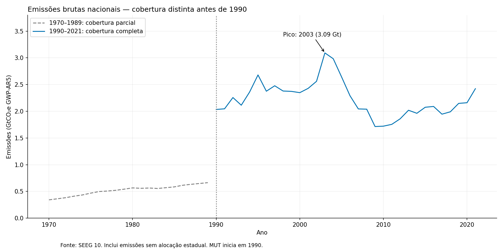
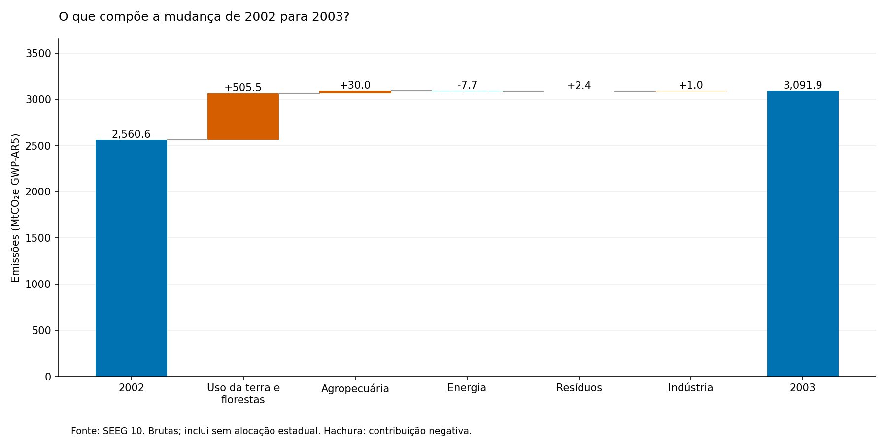
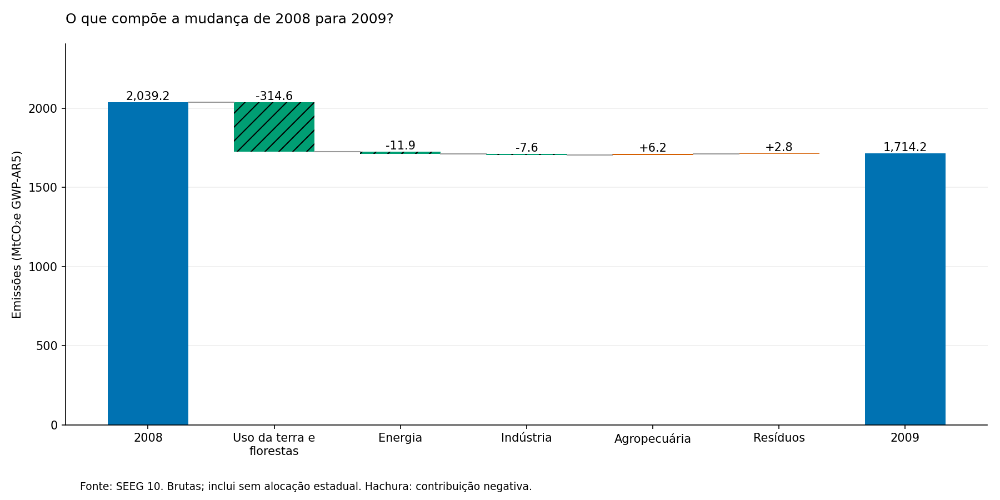
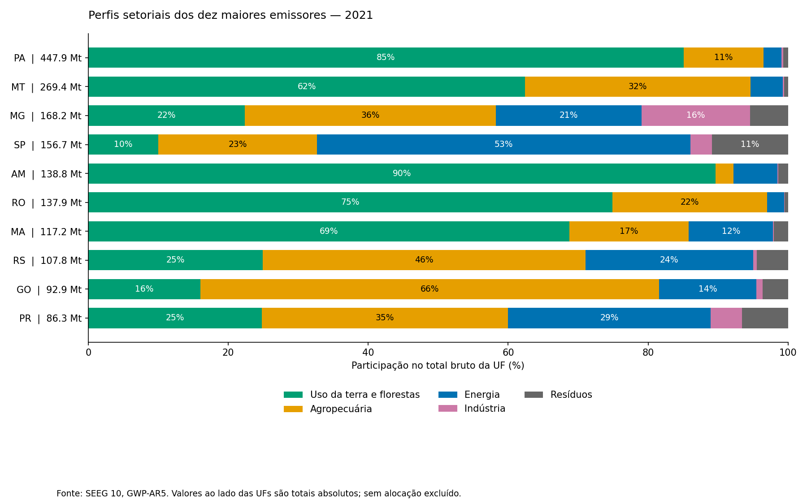
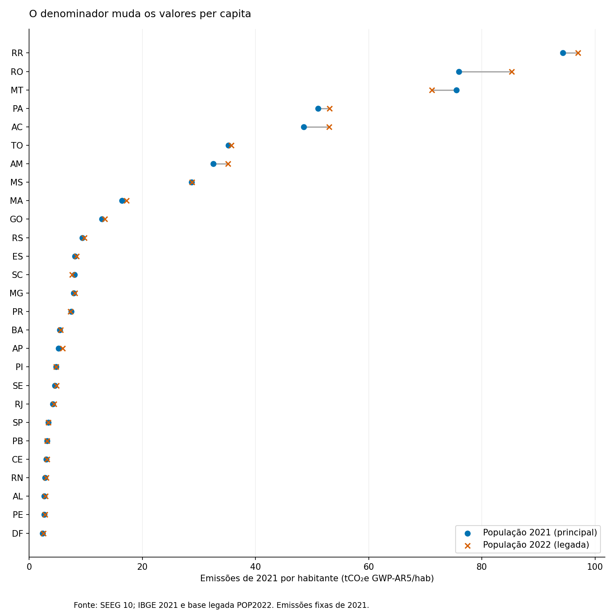
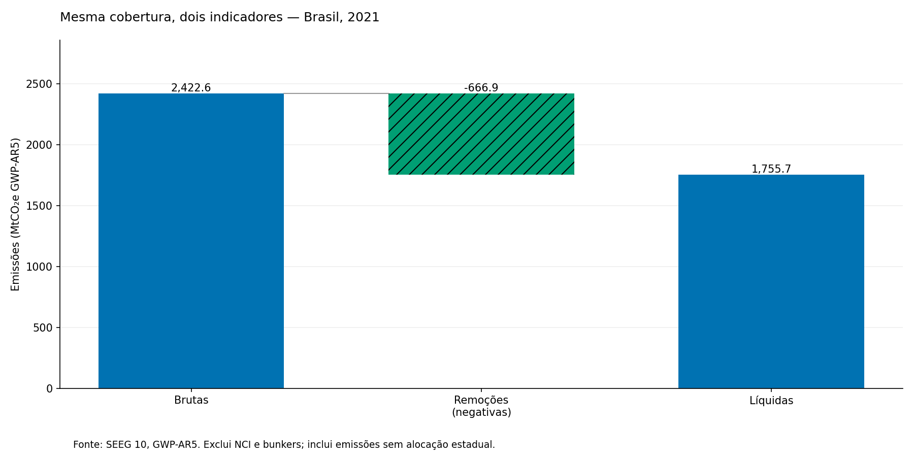

# Brazil Greenhouse Gas Emissions Analysis

Análise reproduzível das emissões brasileiras de gases de efeito estufa, com dados históricos do **SEEG 10 (1970–2021)** e população do **IBGE de julho de 2021**. O projeto conecta preparação, validação, visualização e interpretação dos resultados.

## Principais resultados

- **2021:** 2.423 GtCO₂e brutas e 1.756 GtCO₂e líquidas, após incorporar -666.9 MtCO₂e de remoções assinadas. Ambos usam GWP-AR5 e excluem NCI e bunkers.
- **2002→2003:** Uso da Terra e Floresta contribuiu com +505.5 MtCO₂e para a mudança nacional. **2008→2009:** o mesmo setor contribuiu com -314.6 MtCO₂e. São contribuições contábeis, sem atribuição causal.
- **Perfis estaduais:** Uso da Terra e Floresta responde por 85.1% do bruto do Pará; Energia, por 53.4% do bruto de São Paulo. Rankings semelhantes podem esconder composições diferentes.
- **Per capita:** ao substituir a base populacional legada de 2022 pela estimativa de 2021, seis UFs mudam de posição. O numerador de emissões permanece idêntico; isso não representa queda das emissões.
- **Cobertura:** 85.6 MtCO₂e (3.53%) do bruto nacional não estão alocadas a estados. Essa parcela entra no total nacional, mas não nos rankings de UFs.

Os resultados retratam a edição histórica utilizada, **não as emissões atuais do Brasil**. Gt = bilhões de toneladas; Mt = milhões de toneladas.

## Perguntas respondidas

1. Quais estados lideram em emissões brutas e por habitante?
2. Quais setores compõem as emissões de cada estado?
3. Que contribuições setoriais explicam aritmeticamente a alta de 2003 e a queda de 2009?
4. Como a população usada no denominador afeta o ranking?
5. Qual a diferença entre emissões brutas e saldo líquido?

## Visualizações e interpretação

### Evolução histórica e comparabilidade



Mudança de Uso da Terra e Floresta só possui cobertura desde 1990. A linha anterior é exibida separadamente como cobertura parcial; não se interpreta o salto 1989→1990 como crescimento real. Taxas nacionais de mesma cobertura começam em 1991.

### O que compõe as mudanças de 2003 e 2009?





Cada gráfico reconcilia o total inicial, os deltas dos cinco setores e o total final. Contribuições positivas e negativas podem se compensar; a tabela também traz contribuições em pontos percentuais da taxa nacional. Esses cálculos não isolam causas, efeitos de políticas ou mecanismos econômicos.

### Composição dos estados



As barras mostram percentuais; os rótulos das UFs preservam os totais absolutos. A tabela exportada cobre 27 UFs × 5 setores. Processos Industriais em AC, AP e RR não possuem registros: esses valores ficam ausentes, com indicador de cobertura, sem presumir emissão zero. Os dez estados do gráfico têm registros nos cinco setores. [Detalhes](docs/sector-analysis.md).

### Sensibilidade do indicador per capita



O indicador principal usa população de julho de 2021. A versão legada de 2022 é um cenário de sensibilidade, e não um segundo ano de emissões. Diferenças entre denominadores incluem mudanças de levantamento/metodologia, além da referência temporal. Per capita é uma razão territorial, não a pegada de consumo dos habitantes. [Fonte e integração](docs/population.md).

### Brutas e líquidas



O arquivo original já registra remoções negativas: **líquidas = brutas + remoções assinadas**. Rankings, participações e séries anteriores usam o bruto. Não transferir suas conclusões automaticamente para o líquido. [Categorias, sinais e limites](docs/methodology.md).

## Fontes e método

- **SEEG / Observatório do Clima:** arquivo `1-SEEG10_GERAL-BR_UF_2022.10.27-FINAL-SITE.xlsx`, aba `GEE Estados`, métrica única `CO2e (t) GWP-AR5`.
- **[Relatório SEEG 10](https://energiaeambiente.org.br/wp-content/uploads/2023/04/SEEG-10-anos-v5.pdf):** referência para cobertura, categorias e definição do balanço.
- **[IBGE, estimativa DOU 2021](https://ftp.ibge.gov.br/Estimativas_de_Populacao/Estimativas_2021/estimativa_dou_2021.xls):** referência populacional em 1º de julho de 2021, publicação de agosto de 2021. Os totais municipais são reconciliados com a tabela oficial de UFs do mesmo arquivo.
- **Base legada IBGE 2022:** preservada para comparação com a versão anterior do projeto.

Os arquivos brutos são preservados no repositório. [Manifesto de fontes e SHA-256](docs/sources.json), [metodologia completa](docs/methodology.md). O total nacional soma registros elegíveis com e sem UF; agregados `BR` nunca são somados automaticamente aos componentes.

## Como reproduzir

Use **Python 3.11**. Execute na raiz do repositório:

```bash
git clone https://github.com/GustavoMedeiros601/brazil-ghg-emissions-analysis.git
cd brazil-ghg-emissions-analysis
python -m venv .venv
```

Ative o ambiente:

```powershell
# Windows PowerShell
.\.venv\Scripts\Activate.ps1
```

```bash
# Linux/macOS
source .venv/bin/activate
```

Instale as dependências e execute:

```bash
python -m pip install -r requirements.txt
python -m ipykernel install --sys-prefix --name python3
python scripts/run_notebooks.py
python -m unittest discover -s tests -v
```

O executor abre kernels novos e salva as saídas nos notebooks. Também é possível executar interativamente, nesta ordem, da raiz ou da pasta `notebook/`:

1. [Preparação e controles](notebook/01_data_preparation_emissions.ipynb).
2. [Análise e visualizações](notebook/02_exploratory_analysis.ipynb).

Nenhuma cópia ou renomeação manual de CSV é necessária. A primeira execução lê a planilha bruta e pode levar alguns minutos. São necessárias dependências instaladas e espaço para os dados processados e figuras.

## Estrutura e saídas

```text
data/raw/          Fontes fixadas, sem edição manual
data/processed/    CSVs gerados pelo notebook 01
notebook/          Preparação e análise, com saídas salvas
src/ghg.py         Filtros, agregações, população e validações
src/charts.py      Figuras de decomposição e composição
scripts/           Executor dos notebooks
tests/             Testes de integração e regras analíticas
images/            Figuras reproduzíveis usadas neste README
docs/              Metodologia, fontes e limitações
```

| Saída em `data/processed/` | Conteúdo |
|---|---|
| `emissoes_co2e_gwp_ar5_1970_2021.csv` | Registros brutos filtrados, em formato longo |
| `emissao_anual_brasil.csv` | Série nacional com parcela sem alocação |
| `emissao_estado_2021.csv` | Totais brutos das 27 UFs |
| `emissao_setor_2021.csv` | Totais brutos nacionais por setor |
| `emissao_per_capita_2021.csv` | Emissões de 2021 / população de 2021 |
| `alocacao_emissoes_2021.csv` | Reconciliação territorial |
| `sensibilidade_per_capita_2021.csv` | Dois denominadores e mudanças de posição |
| `decomposicao_setorial_historica.csv` | Deltas setoriais e contribuições em p.p. |
| `emissao_uf_setor_2021.csv` | Valores e participações por UF/setor, com cobertura |
| `balanco_nacional_2021.csv`, `balanco_uf_2021.csv` | Brutas, remoções assinadas e líquidas |
| `categorias_seeg_2021.csv` | Auditoria das categorias incluídas e excluídas |

## Critérios de qualidade

Os testes verificam as 27 UFs, municípios únicos, população positiva, correspondência sem multiplicação de linhas, fontes fixadas por hash, estabilidade do numerador na sensibilidade, soma das participações, reconciliação das decomposições, rejeição de remoções com sinal invertido e exclusão de NCI/bunkers. Também comparam os CSVs exportados com as transformações na fonte.

As verificações numéricas usam tolerâncias explícitas em vez de igualdade binária de ponto flutuante. Ausência de registro não é convertida silenciosamente em zero. Dados anteriores a 1990 têm cobertura diferente. As estimativas do SEEG são dados de inventário, não medições diretas de todas as emissões nem evidência causal.

## Autor

**Gustavo Medeiros** — estudante de Engenharia de Software com foco em Dados, BI e Inteligência Artificial.

[LinkedIn](https://www.linkedin.com/in/gustavo-medeiros-m-da-silva-48a11a294)
